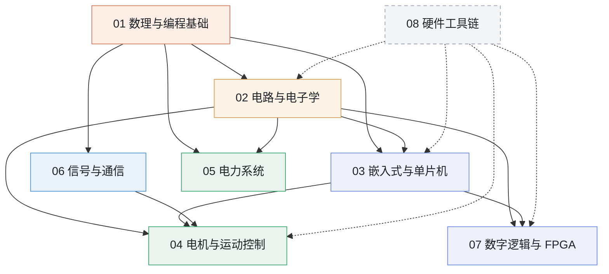

# 路线地图

> 这一页给两张图：第一张是类似 UCB EECS 课程地图的**板块前置依赖图**（谁先学、谁依赖谁）；第二张是本 Wiki 独有的**硬件到软件分层架构图**（每个板块在系统中处于哪一层）。板块细节见各板块页面，这里只看全局关系。

## 一、课程依赖地图（前置关系）

仿照 UCB prerequisite chart 的画法：节点是八个板块，箭头表示**先修依赖**——箭头从先修板块指向后续板块。虚线代表「贯穿全程、不设先后阶段」的工具链板块。

### 依赖关系说明

- **地基只有一个**：[01 数理与编程基础](./01-math-programming/README.md) 是所有后续板块的公共前置，C 语言、高数、概率、物理都在这里打牢。
- **硬件主线**：01 → 02 电路与电子学 → 03 嵌入式与单片机 → 04 电机与运动控制；02 同时通向 07 数字逻辑与 FPGA。
- **信号主线**：01 → 06 信号与通信，再为 04 的控制环与滤波提供频域基础。
- **系统方向**：05 电力系统建立在 01 的数学 / 优化基础与 02 的电路基础之上，与控制、算法结合做集成分析。
- **工具链**：[08 硬件工具链](./08-hardware-toolchain/README.md) 不安排固定阶段，做哪个板块的项目就随时回这里查对应工具。

## 二、硬件 → 软件分层架构图

课程依赖图回答「先学谁」；这张图回答「各板块处在系统的哪一层」。自下而上是**物理器件 → 电路 → 数字固件 → 控制算法 → 应用系统**，越往上越偏软件与抽象，越往下越贴近物理硬件。

  

    L5 · 最偏软件
    应用与系统层
  

  

    
把下层的驱动、算法组装成可运行的完整系统：闭环电机控制产品、电力系统分析与调度平台，面向具体工程目标。

    

      <a class="arch-chip" href="/04-motor-control/README">04 电机与运动控制</a>
      <a class="arch-chip" href="/05-power-system/README">05 电力系统</a>
    

  

  

    L4
    控制与信号算法层
  

  

    
在固件之上做信号处理、建模与闭环算法：时频域分析、滤波、变换、控制律，是连接底层硬件与上层系统的数学桥梁。

    

      <a class="arch-chip" href="/06-signal-communication/README">06 信号与通信</a>
    

  

  

    L3
    数字 / 固件层
  

  

    
让数字硬件跑起程序：MCU 外设驱动与 RTOS、FPGA 上的并行逻辑，把电路层的器件组织成可编程、可配置的数字平台。

    

      <a class="arch-chip" href="/03-embedded-mcu/README">03 嵌入式与单片机</a>
      <a class="arch-chip" href="/07-digital-fpga/README">07 数字逻辑与 FPGA</a>
    

  

  

    L2
    电路与器件层
  

  

    
真实元器件与模拟 / 数字电路：电阻电容电感、放大器、运放、逻辑门，是所有数字设备赖以工作的物理载体。

    

      <a class="arch-chip" href="/02-circuit-electronics/README">02 电路与电子学</a>
    

  

  

    L1 · 最偏硬件
    物理与数理基础层
  

  

    
描述电与运动的底层规律，以及计算所需的数学和第一门语言：大学物理、高数、线代、概率统计、C 语言。

    

      <a class="arch-chip" href="/01-math-programming/README">01 数理与编程基础</a>
    

  

  贯穿全程
  <a href="/08-hardware-toolchain/README">08 硬件工具链</a> —— EDA / PCB、仿真、测量仪器、调试与版本管理，支撑从 L1 到 L5 的每一层，不单独占一个学习阶段。

## 三、推荐学习阶段

| 阶段 | 包含板块 | 目标 |
|---|---|---|
| **基础打底** | [01 数理与编程基础](./01-math-programming/README.md) | 语言、数学与物理过关，具备后续计算与建模能力 |
| **硬件入门** | [02 电路与电子学](./02-circuit-electronics/README.md)、[06 信号与通信](./06-signal-communication/README.md) | 看懂电路、掌握信号与频域分析 |
| **数字平台** | [03 嵌入式与单片机](./03-embedded-mcu/README.md)、[07 数字逻辑与 FPGA](./07-digital-fpga/README.md) | 在 MCU / FPGA 上驱动外设、组织并行逻辑 |
| **系统集成** | [04 电机与运动控制](./04-motor-control/README.md)、[05 电力系统](./05-power-system/README.md) | 完成闭环控制、电力分析与优化等完整工程 |
| **按需查阅** | [08 硬件工具链](./08-hardware-toolchain/README.md) | 做项目时回查对应工具与仪器用法 |

> 板块的完整索引、每门课程与笔记的位置，见 [路线总览](./README.md)；电子书、公开课、资源网站与工具清单见 [附录](./appendix/README.md)。
